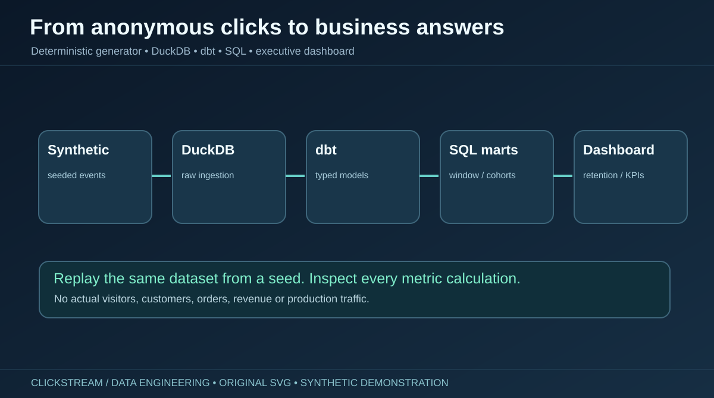

# Clickstream Intelligence | Big Data Analytics & Advanced SQL



[](https://github.com/harshakavali81-collab/Big-Data-Analytics-Advanced-SQL/actions/workflows/ci.yml)

A reproducible, **synthetic** customer-behavior warehouse showcasing advanced SQL, DuckDB, dbt, Python, data-quality checks, and an interactive local Streamlit executive dashboard. Built as a technical portfolio case study for Data Analyst, Analytics Engineer, and Data Engineer interviews.

**Important:** all clickstream rows, conversion rates, visits, customer IDs, events and transactions are fabricated. No actual users, production revenue or independently validated big-data throughput.

## Quick start (Python 3.11+)

~~~bash
git clone https://github.com/harshakavali81-collab/Big-Data-Analytics-Advanced-SQL.git
cd Big-Data-Analytics-Advanced-SQL
python -m venv .venv
# Windows: .venv\Scripts\activate
# macOS / Linux: source .venv/bin/activate
python -m pip install -r requirements.txt
python -m scripts.run_pipeline --sessions 2500 --seed 42 --days 90
streamlit run dashboard/app.py
~~~

### Rebuild a larger fictional dataset

~~~bash
python -m scripts.run_pipeline --sessions 100000 --seed 42 --days 90
python -m pytest -q
~~~

Higher-scale data generation is configurable; **100,000 sessions is not a published benchmark or proof of cloud scalability**.

## Pipeline

~~~mermaid
flowchart LR
    A[Python synthetic event generator] --> B[CSV in data/generated]
    B --> C[(DuckDB raw schema)]
    C --> D[dbt staging]
    D --> E[dbt session model]
    E --> F[Daily, channel, customer &amp; retention marts]
    D --> G[Product performance mart]
    F --> H[Streamlit dashboard / JSON export]
    G --> H
~~~

## Repository layout

~~~text
big-data-clickstream-analytics/
├── .github/workflows/ci.yml
├── assets/                    10 original SVG visuals
├── data/generated/            ignored generated CSV and DuckDB
├── generators/                deterministic session simulator
├── scripts/                   ingestion, pipeline and JSON export
├── notebooks/                 exploratory Jupyter notebooks
├── warehouse/
│   ├── dbt_project.yml
│   ├── profiles.yml
│   ├── models/
│   │   ├── staging/
│   │   ├── intermediate/
│   │   └── marts/
│   └── tests/                 custom dbt contracts
├── sql/                       six advanced SQL examples
├── dashboard/                 Streamlit app + standalone visual gallery
├── tests/                     pytest suite
└── docs/                      architecture, metrics, dictionary, case study
~~~

## Metrics and grain

| Metric | Precise definition |
|---|---|
| Sessions | Count of distinct simulated session IDs, grouped by session start date |
| Conversion % | Purchasing sessions / all sessions × 100 |
| Daily revenue | Sum of simulated purchase-event amounts, attributed to session start |
| Average order value | Synthetic revenue / purchasing sessions |
| Weekly retention | Activity among users in a signup cohort after N calendar weeks |
| Acquisition channel | One generated channel per session |
| Customer value | Summed generated revenue per fictional user |
| Product performance | Views, carts, purchases and synthetic revenue per product |

## Ten original diagrams and illustrations

1. [From anonymous clicks to business answers](assets/01-hero.svg)
2. [Warehouse architecture](assets/02-architecture.svg)
3. [Session event taxonomy](assets/03-event-taxonomy.svg)
4. [Analytics data model](assets/04-warehouse-model.svg)
5. [Session conversion funnel](assets/05-conversion-funnel.svg)
6. [Acquisition channel comparison](assets/06-channel-performance.svg)
7. [Weekly cohort retention matrix](assets/07-cohort-retention.svg)
8. [Seven-day KPI trend](assets/08-rolling-kpis.svg)
9. [Customer value segmentation](assets/09-customer-segments.svg)
10. [Quality, testing and reproducibility](assets/10-quality-checks.svg)

The graphics are **illustrative**; charts do not represent measured model outputs. To inspect computed data, run the Streamlit dashboard locally.

## Advanced SQL topics

- [Window functions, cumulative customer value](sql/01_window_functions.sql)
- [Cohort retention](sql/02_cohort_retention.sql)
- [Session-level funnel](sql/03_conversion_funnel.sql)
- [Rolling seven-row KPI calculations](sql/04_rolling_metrics.sql)
- [Acquisition-channel ranking](sql/05_channel_rank.sql)
- [RFM-style segmentation](sql/06_rfm_segments.sql)

## Data quality and test automation

~~~bash
python -m pytest -q
dbt run --project-dir warehouse --profiles-dir warehouse
dbt test --project-dir warehouse --profiles-dir warehouse
~~~

GitHub Actions re-runs the test suite and a complete synthetic-data build on every push. Check the live workflow status to confirm success. Generated files, DuckDB, local dbt build output and credentials are excluded from Git.

## Dashboards

- **Dynamic interactive dashboard:** dashboard/app.py queries local DuckDB marts and displays conversion, channel comparisons, revenue trends, retention heatmaps, product views and customer value.
- **Static visual gallery:** [dashboard/index.html](dashboard/index.html) is a browser-friendly, responsive showcase of ten original visuals. Unlike Streamlit, it is not connected to a running warehouse.
- **Portfolio case study:** [project narrative](docs/CASE_STUDY.md) and [engineering explanation](docs/ARCHITECTURE.md).

## Documentation

[Architecture](docs/ARCHITECTURE.md) · [Metric definitions](docs/METRIC_DEFINITIONS.md) · [Data dictionary](docs/DATA_DICTIONARY.md) · [Deployment scope](docs/DEPLOYMENT.md) · [Graphics guide](docs/GRAPHICS.md)

## Honest limitations

This is an educational local analytic warehouse, not a verified production service or live ecommerce dashboard. Cloud scheduling, sensitive-data governance, enterprise auth, freshness alerting, and independently measured large-scale performance remain separate implementation work.

**Creator:** Kavali Harshavardhan · Python · DuckDB · dbt · Advanced SQL · Streamlit

## Interactive public demo (no account needed)

**[Launch the interactive Clickstream Intelligence dashboard](https://harshakavali81-collab.github.io/harshavardhan-portfolio/bigdata-demo.html)** · [Read the portfolio case study](https://harshakavali81-collab.github.io/harshavardhan-portfolio/cases/big-data-clickstream.html)

Unlike the ten introductory illustrations, this browser interface reads reproducible **computed** synthetic DuckDB/dbt aggregates. It offers date range filtering, KPI cards, real graph rendering, acquisition channels, device breakdown, cohort retention, product analysis and a daily CSV export. See [Public Demo](docs/PUBLIC_DEMO.md) for data boundaries and refresh limitations.

## Containerized local Streamlit application

```bash
docker compose up --build -d
# Open http://localhost:8501 in your browser
docker compose down
```

The container prepares the warehouse from seed 42 at build time. The public Pages demonstration is separate: it does not run Python, Streamlit or real-time order ingestion.

## Independent quality audit and Parquet support

```bash
python -m scripts.check_integrity
python -m scripts.export_parquet
python -m scripts.benchmark --sessions 10000 --output data/generated/benchmark.json
```

Parquet exports contain **synthetic events** and are limited to local/CI artifacts, while the public JSON contains aggregate reports only. Benchmark timings depend on the machine and are not cloud throughput guarantees.

[Reproduction](docs/REPRODUCIBILITY.md) · [Security and privacy](docs/SECURITY.md) · [Test matrix](docs/TEST_MATRIX.md) · [Public dashboard details](docs/PUBLIC_DEMO.md)
