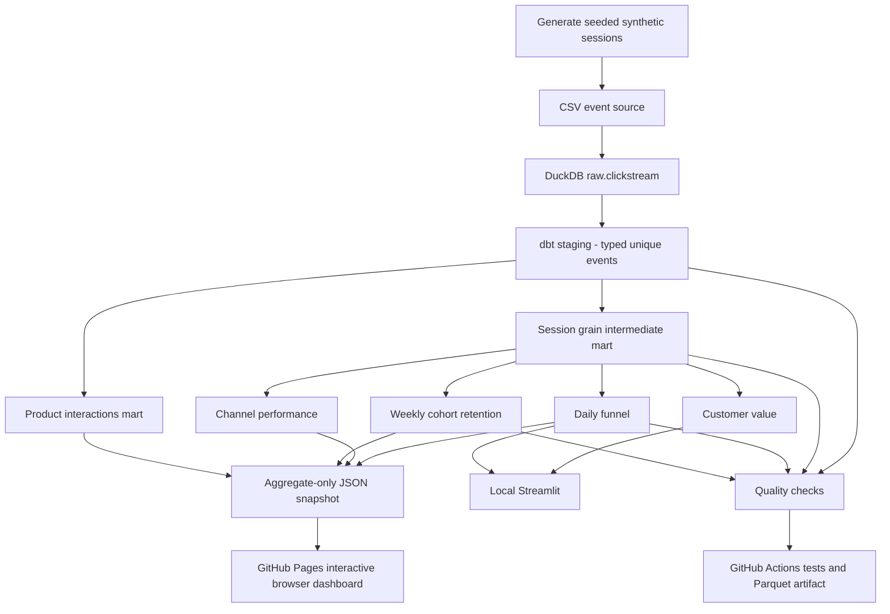

# Detailed project workflow

## Data layers

1. **Generator:** use a stable seed to create fictional sessions, events, devices and channels, with purchases only after checkout.
2. **Raw ingestion:** `scripts/load_duckdb.py` uses an all-VARCHAR load to preserve source strings before explicit casts.
3. **Staging:** `stg_events.sql` defines typed timestamp, revenue and event-category columns and validates event IDs.
4. **Intermediate:** `int_sessions.sql` reduces multi-event records into one per session with conversion flags.
5. **Marts:** daily funnel, channel conversion, weekly activity retention, customer RFM-style descriptors and product performance.
6. **Audit:** dbt schema tests and additional SQL checks for uniqueness, event ordering, source attribution, revenue and counts.
7. **Exports:** privacy-safe dashboard JSON, optional date-partitioned ZSTD Parquet for synthetic events and local Streamlit queries.
8. **Visuals:** ten original illustrative SVG diagrams plus genuine computed public and local dashboard charts.
9. **CI:** rerun tests and exports; store Parquet as short-retention build artifact and refresh a safe aggregate JSON snapshot.
10. **Portfolio:** static GitHub Pages website consumes a copy of the fixed-seed aggregates for interactive browsing.

## Grain relationships

- One `event_id` = one generated activity
- One `session_id` = one synthetic journey (multiple events)
- One `user_id` = one fictional recurring customer (multiple sessions)
- One `date` = one session-start reporting day
- One `cohort_week, weeks_since_first` = one cohort retention observation
- One `product_id` = one simulated product SKU

## Operational boundaries

This is an offline reproducible analytics application. It has no customer collection SDK, queue-based streaming ingestion, real order feed, data consent service, scheduled live cloud pipeline, production tenant isolation or externally validated business accuracy.
